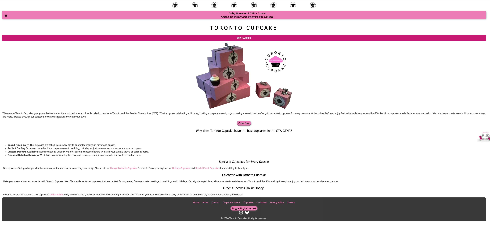
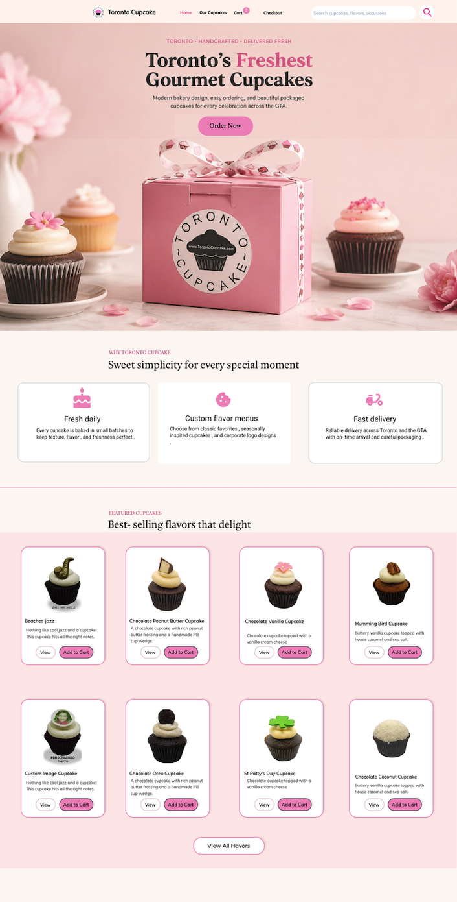
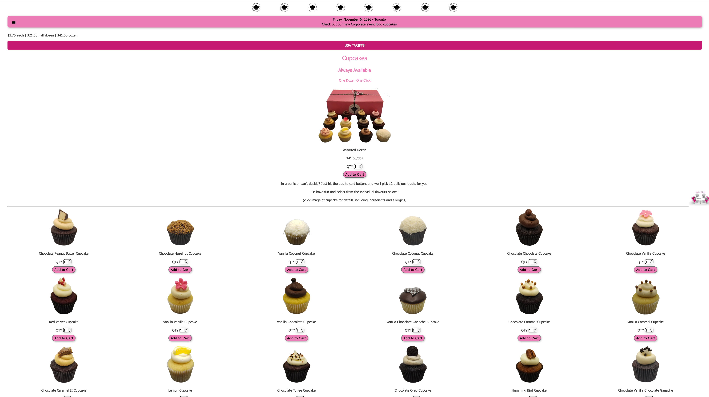
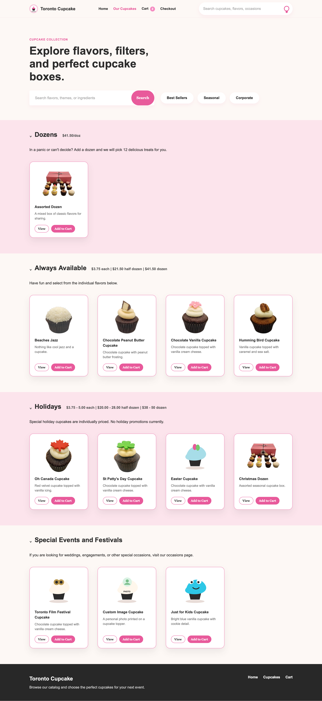
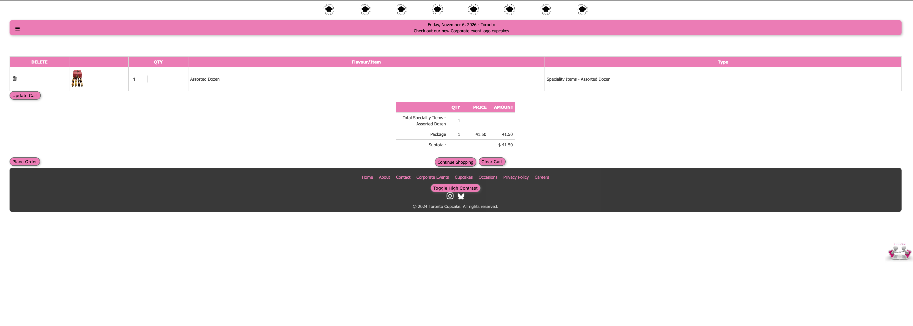
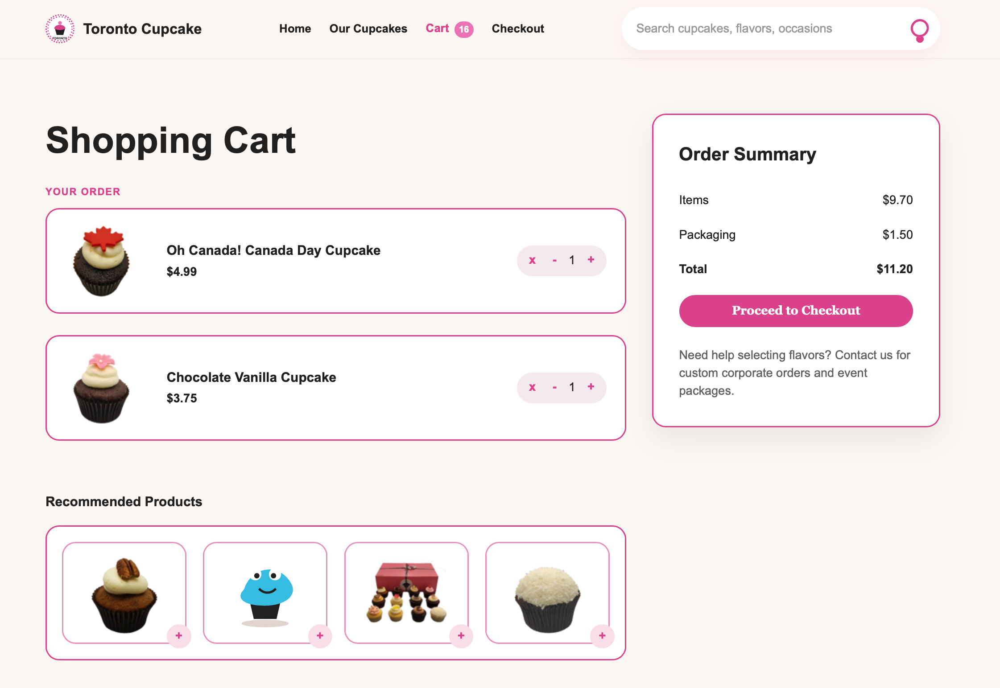
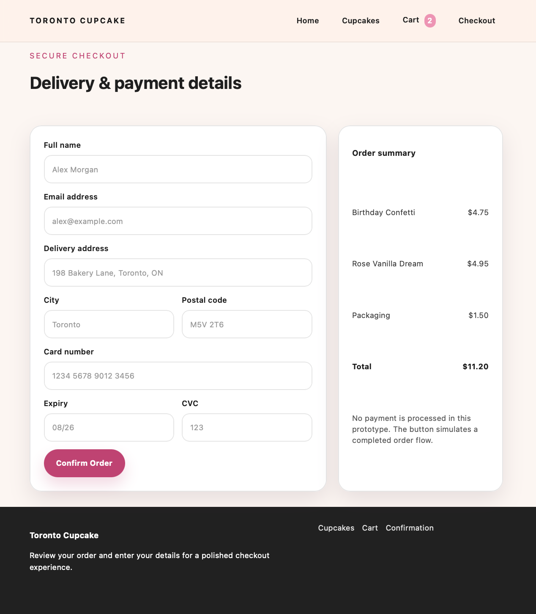

# Toronto Cupcake Redesign

A modern UI/UX redesign prototype of the original Toronto Cupcake website, developed as part of the CIS 386 – Human-Computer Interaction (HCI) course project. Designed by: Zaid Al-Obaidi

## Project Overview

The original Toronto Cupcake website presented several usability issues, including:

* Navigation placed at the bottom of the page
* Large blocks of text that were difficult to scan
* Overwhelming product browsing experience
* No search or filtering capabilities
* Poor checkout workflow
* Outdated visual design

This project redesigns the website by applying core HCI principles to create a cleaner, more accessible, and user-friendly experience.

## HCI Principles Applied

* Visibility: Important actions and navigation are immediately accessible.
* Consistency: Reusable layouts, buttons, and typography throughout the website.
* Cognitive Load Reduction: Information is organized into cards and sections for easier scanning.
* Accessibility: Improved spacing, contrast, and visual hierarchy.
* User Control and Flexibility: Product categories organize browsing; proposed search and filter controls illustrate the intended browsing experience.
* Efficiency: Streamlined cart and checkout process.

## Features

### Home Page

* Modern hero section
* Featured cupcakes section
* Customer testimonials
* Corporate orders banner
* Social media section
* Responsive navigation bar


The original home page places a centered product image above long lines of introductory text, with a compact “Order Now” button and text navigation in the footer. A hamburger menu is also available at the top.



The redesign exposes the main navigation across the header and brings the headline, product photography, and “Order Now” action together in a prominent hero. Short benefit cards and featured products break the content into sections that are easier to scan.



### Cupcake Catalog

* Search bar
* Category filter controls (visual prototype)
* Organized product sections
* Product cards with images and actions


The original catalog gives the assorted dozen a large introductory area, followed by a wide grid of individual cupcakes with small labels and quantity controls. The products share an open background with little visual separation.



The redesign groups products into clearly titled sections such as Dozens, Always Available, and Holidays. Bordered cards keep each image, description, and action together, while alternating background colors separate the groups. Search and category controls appear above the catalog as proposed browsing aids; they are visual placeholders in this prototype.



### Shopping Cart

* Quantity controls
* Order summary
* Recommended products
* Checkout button


The original cart uses a full-width table, a small totals block below it, and a “Place Order” button at the far left. This separates the next step from the order total.



The redesigned cart uses larger item cards with product images, prices, and adjacent quantity controls. A dedicated summary panel places the total directly above “Proceed to Checkout,” making the next step more prominent. Recommended products sit beneath the order. The displayed items, totals, and badge counts are prototype sample states rather than a synchronized live order.



### Checkout

* Delivery and payment form
* Order summary panel
* Confirmation workflow


The redesigned checkout continues the ordering flow with clearly labeled delivery and payment fields in one panel and an order summary beside them. Related fields, such as city and postal code, are grouped together, and the pink “Confirm Order” button marks the final action. This screen demonstrates the proposed form layout; payment processing is simulated.



### Order Confirmation

* Success message
* Order completion feedback
* Return to home navigation

## Technologies Used

* HTML5
* CSS3
* Vanilla JavaScript
* Responsive Web Design
* Flexbox
* CSS Grid

## Project Structure

```text
toronto-cupcake-redesign/
│
├── index.html
├── cupcakes.html
├── cart.html
├── checkout.html
├── confirmation.html
│
├── css/
│   └── style.css
│
├── js/
│   └── script.js
│
└── assets/
    ├── images/
    └── icons/
```

README images are stored in `docs/screenshots/` at the repository root.

## Color Palette

| Color | Hex |
| --- | --- |
| Background | `#FDF8F5` |
| Primary Pink | `#E85A9B` |
| Light Pink | `#FCE4EC` |
| Text | `#2B2B2B` |
| White | `#FFFFFF` |

## Screens

* Home Page
* Cupcake Catalog
* Shopping Cart
* Checkout
* Order Confirmation

## Educational Purpose

This project is a static front-end prototype created for academic purposes only. No backend services, database, authentication, or real payment processing are implemented.

Course: CIS 386 – Human-Computer Interaction
Project: Redesigning a Poor User Experience – Toronto Cupcake
Type: UI/UX Prototype and Front-End Implementation
